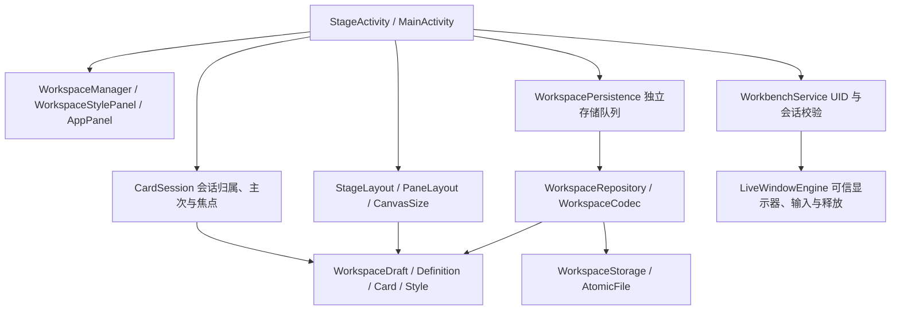

# 工作台架构与持续开发

## 当前窗口操作、Dock 与展示边界（test.9）

test.9 在支持的系统上把应用逻辑画布与显示器缓冲区分离。`LiveCanvasArea` 只在 `LiveWindowEngine` 自己创建的显示器内建立根级 TaskDisplayArea；VirtualDisplay 和 TextureView 保持 1920 × 1920 缓冲区，应用区域按实际画布裁剪。改变成员尺寸只修改这个区域，不触发显示器尺寸变化的系统截图过渡。不得注册全局 DisplayAreaOrganizer，不能把任意任务 token 或远程命令暴露给 App；接续任务仍先校验来源、用户和所有权，退出仍先交还后台，再释放显示器及本区域。API 不支持或特殊兼容画布超过缓冲区时保留原显示器调整路径。稳定画布的输入法使用该显示器的 fallback 策略，由物理显示器完整呈现键盘，输入仍路由到焦点成员；不能把键盘按 1920 方形缓冲区放置后裁掉按键，也不改系统全局输入法设置。

`LiveCanvasSync` 在服务适配层提交 BLAST 同步事务，等待应用提交新尺寸的画面；等待发生在显示器操作队列。`CanvasCommitQueue` 是纯 Java 帧提交队列，按实际 SurfaceTexture 帧时间选择已完成的画布；`StageActivity` 在取得该帧时同步更新裁剪、布局与变换，避免新像素和旧几何错配。旧 Surface、TextureView 和真实帧持续复用，不用截图或加载层掩盖关闭。`CanvasSize.paneWithin` 让同卡片成员共用像素比例；扩展剩余成员时保留已有密度，避免仅因关闭邻窗就触发不处理 density 配置的应用重建。缩小、旋转仍按需要调整。见 [帧同步与关闭复验](split-close-frame-sync-validation.md)。

`HostImeLayer` 在宿主附着一个透明、不可触摸且不获取输入焦点的 1 px 子窗口，仅作为物理屏 fallback IME 的层级目标，避免键盘继续依附已隐藏的管理首页。使用公开 WindowManager API，随 Activity 销毁；主承载窗口仍保持可聚焦和 `FLAG_ALT_FOCUSABLE_IM`，不改真实应用画布。

`LiveWindowEngine.focus` 仅记录实时确认取得输入焦点的自有任务 token，限当前会话，不持久化。菜单取得宿主焦点后，关闭流程仍可依据这份输入归属收尾。`LiveTaskHandoff` 隐藏将退出的自有显示器任务时，暂时停止已确认可获取焦点的任务接收输入；迁回物理屏后，与后台排序、恢复可见性一起恢复可聚焦状态，异常清理也执行恢复。仅限制 TaskDisplayArea 不够：任务离开区域时会立即继承物理屏的可聚焦状态，可能重新唤起 fallback 键盘。不得长期禁用返回给用户的任务，也不改变剩余成员、宿主的 `FLAG_ALT_FOCUSABLE_IM` 或全局输入法。

test.8 的关闭补位保持现有实时画面。`StageActivity.liveReflow` 跨越成员移除、布局复算和异步 resize 回调，直到运动及画布提交结束；这些回调重定向现有运动目标，不能用 `arrange(false)` 打断。实际变化的画布仍只调整一次，但不为已经呈现的窗口盖加载层。窗口的显示宽、高分别由 `StageMotion` 管理，避免逻辑画布比例改变时显示高度跳变；`StageLayout.CardPose` 的纵向缩放、透视中心和位移使用同一个 scaleY，`StageCardPose` 只应用变换。继续复用 TextureView、Surface 和 display；单次关闭与快速连续关闭不引入截图替代、Surface 重建或配置字段。验证必须同时检查实际变换后的边界与录屏画面，不能只看最终布局。见 [关闭闪烁验证](split-close-smooth-validation.md)。

用户否定 test.6 常驻叉号对应用内容的遮挡，test.7 删除 `WindowCloseButton`、相关几何和 Activity 生命周期分支。`SplitDivider` 保留原来的拖动区域、预览及提交路径，轻点时传入卡片、相邻边界、方向与锚点，由 Activity 绑定对应 AppWindow；独立的 `SplitWindowMenu` 只负责两行应用图标、名称、左右/上下方位和“关闭”动作，以及原分屏布局入口。菜单按需使用既有 HostModalSurface，不增加常驻标题栏、不缩减应用区域、不重建 Surface。Dock 长按/右键继续支持单窗口操作。关闭复用原 `remove` → `CardSession.remove` → 后台任务交还路径，不增加权限或配置字段；其余成员的身份、顺序和相对比例保留。见 [不遮挡内容的窗口操作验证](split-actions-validation.md)；[test.6 记录](split-close-validation.md) 仅为被用户否定的历史方案。

`StageDock` 自身测量真实内容宽度，在父容器安全边距内收紧；内部只有应用条横向滚动，右侧添加按钮固定可见。图标和状态标记使用固定 dp 几何，标记不再依赖字体；背景、选中边框和矢量加号统一视觉。稳定窗口/启动组件对应的 Tile 在刷新时复用，避免切换焦点和图标回调重建整排、丢失滚动位置。`StageActivity` 只传数据和动作，不再估算 Dock 宽度。56 dp 高度、62 dp 画布占位基准保持，显隐及外观修改不触发应用 resize。

用户明确不需要窗口总览，已移除 `OverviewPages`、`OverviewControls`、`WindowOverview`，以及 StageLayout 总览几何、StagePresentation 总览状态、StageActivity 的分页/过滤/标题/命中分支。菜单、同应用窗口菜单、Dock、四/五指上滑、Ctrl+Alt+O 不再提供总览；左右切换和捏合回桌面仍保留。以下历史 test.1–4 中的总览说明仅描述旧版。配置没有持久化总览状态，因此 schema 8 不变；多实例、分屏、最小化、两种全屏及资源复用规则继续保留。

当前测试源码为 **0.17.0-test.9 / schema 8**。Dock 呈现与总览移除见 [test.5 记录](dock-style-validation.md)。相邻成员独立分隔条、实时画面跟随及比例迁移见 [分屏记录](split-live-validation.md)。test.3 占满修正见 [历史记录](split-fill-validation.md)，旧版 Dock 偏好、分页总览、多指手势和应用恢复见 [平板测试版记录](tablet-test2-validation.md)；test.1 自由几何、窗口身份、多实例与暂离会话见 [首批测试台账](stage-manager-test-development.md)。下文 0.16.0 描述为原有架构基线；扩展见文末，双屏和内容拖放仍不是可用功能。

0.16.0，2026-11-13。在单 APK、免 root 和内置无线 / 备用 USB 激活方式下实现最近应用接续、工作台组合、侧栏/背景/比例设置、桌面快捷方式和多应用卡片。本轮全屏改动已通过自动检查，尚待实机复验。

## 应用组合的入口

应用组合保存一套应用列表，下次一键进入工作台；分屏卡片是卡片内部的布局，两者使用明确独立的产品名称。

`ApplicationSetEditor` 复用 `AppPanel` 的选择模式，编辑独立的 `WorkspaceDraft`。只选择、排序、设默认主应用和命名保存，不接触实时窗口服务、不改当前草稿；选中的每个应用创建独立卡片。`WorkspaceLabels` 提供统一应用名称摘要。

`MainActivity` 载入整个配置库，在启动页展示已保存组合及应用名单，点击后通过 Repository.activate 再启动 StageActivity，一次载入所有应用。生命周期和加载代次防止过期回调从后台启动工作台；管理后刷新列表；启动页和选择面板支持原地旋转。已有保存组合及分屏结构继续按原定义打开。

0.14.8 将首页呈现抽到 `HomeScreen`：主卡片、最近入口、组合网格、激活状态及空态均由同一宽度规则重排，交互通过窄回调交给 `MainActivity`。`HomeAppAssets` 在独立线程读取标签及图标，使用加载代次丢弃旧结果，销毁时结束队列；不在输入和渲染时读取包资源。`HomeWorkspacePreview` 用真实配置和图标绘制静态示意，保留多应用卡片的组边界，不截取应用、不启动任务、不声称是实时画面。激活和数据加载状态更新不重建 Activity；首页样式不进入 shell 服务或持久模型，文字集中在 `res/values/home.xml`。版本、USB 和诊断保留在帮助入口。见 [首页验证](home-ui-validation.md)。

「从最近应用进入工作台」由 `RecentEntry` 异步读取服务返回的组件列表，再交给 `WorkspacePersistence.enterRecent`。纯 Java `RecentWorkspace` 把最多五个不同包的近期应用排到当前草稿前面；已有分屏按整张卡片移动，首个近期成员获得焦点，原卡片 ID、缺失应用和余下卡片保留。保存成功才启动；保存组合不变。首页主入口在当前草稿为空时也复用同一最近应用管线；非空的「继续上次」和已保存组合入口不导入最近列表。用户明确创建空白工作台仍直接打开空白选择面板，不立即导入最近列表。

`AppPanel` 是自适应全屏应用抽屉，图标目录、中文转拼音与最近排序数据在后台读取，支持搜索和字母跳转。添加模式点选一个应用后立即关闭，再加入或切换该应用；组合编辑模式仍允许多选，只修改独立草稿。「已加入」列表保留排序、切主窗与移除。`PickerBackdrop` 在抽屉期间暂时隐藏宿主窗口合成画面，关闭后恢复透明度和背景，不拆除 TextureView/Surface；宿主焦点仍由原弹窗恢复路径管理。

0.15.0 的 `EntryRoute` 负责一次启动 Intent 的自动进入状态：激活和配置加载都就绪后直接进入 Stage；非空草稿保持原应用顺序，空草稿复用最近应用入口。`MainActivity` 使用 singleTask 接收桌面重新启动 Intent；显式 `EXTRA_SHOW_HOME` 消耗自动进入，Stage 左上角及菜单退出返回管理首页，状态刷新不会把用户弹回 Stage。保存组合快捷方式优先，后台或过期回调不启动页面。物理返回手势继续交给当前应用。见 [入口与更新验证](direct-entry-update-validation.md)。

## 配置与保存

`model/` 为纯 Java、不可变配置快照。`WorkspaceLibrary.current` 是自动保存的草稿，`saved` 为用户显式保存的配方。每个工作台和卡片使用稳定 ID；一个卡片包含多个 `AppTarget`、焦点成员、按稳定窗口 ID 保存的各成员比例和排列方向。0.17 测试版中默认实例按包去重，额外实例用独立 UUID；同一窗口 ID 只有一个所属卡片。是否支持多个真实任务仍受应用行为限制。

`WorkspaceRepository` 提供保存新组合、打开、重命名、显式覆盖和删除命令。打开组合复制为 `current`；主次交换、组内焦点改变及样式编辑只改草稿。旧快照不会随着草稿修改而变化。快捷方式只携带保存组合 ID，删除组合后禁用对应快捷方式；入口检查激活状态、解析已保存 ID 后启动，不从外部 Intent 接受任意应用启动列表或 shell 命令。

唯一配置文件为私有 `files/workspaces.json`；0.16 使用 schema 4，当前测试版为 schema 8，迁移见文末。旧 `SharedPreferences.components` 只做一次迁移源，原值保留。schema 1 迁移补全布局/背景配置，schema 2 迁移补全宽高比，schema 3 迁移补全 `wallpaperBackground=false`，保留旧颜色/图片背景；新配置默认使用系统壁纸。壁纸与自选图片互斥，稳定卡片 ID 不变；版本化迁移通过原子写入后才发布缓存。损坏、未来版本和写入失败保留原文件。`live_scene`、`visible_components`、`rail_add`、内存等 SharedPreferences 字段仅用于诊断，不恢复运行状态。

持久化只在 `data/` 的单线程队列进行，不占用动画、触控或 PSS 采样队列。实时窗口与配置层继续使用原生 Java；无线配对模块内置固定版本 LibADB Android BC 和 Bouncy Castle，许可保留在 third_party 与 APK 内。JUnit/JSON-java 仅用于 JVM 测试。[AtomicFile](https://developer.android.com/reference/android/util/AtomicFile) 的互斥由单入口保证，shell 服务不读写配置。尚未完成的异步写入遇到进程强杀仍可能丢失最后一次操作，原子替换保证的是文件完整性。

## 卡片与真实窗口

`CardSession` 是纯 Java 的会话协调器：映射临时窗口 ID 到持久卡片、控制主次交换、组内焦点、排序、合并和拆分，并缓存成员关系以减少每帧分配。缺失应用保留在配置中；删除一个成员不删除整个组。`StageSlots` 保留旧单应用算法的历史测试，当前卡片路径使用 `CardSession`。

每个真实应用继续有独立的可信 VirtualDisplay 和 TextureView。一张卡片的所有成员一起交换主次，组内点击选择输入目标；返回发送给该成员。侧窗横滑作用于整张卡片，已加入列表的“移除”作用于单个成员。

`StageLayout` 统一主位、侧栏、末尾加号、左右侧栏、紧凑样式、主窗缩放和宽高比；`PaneLayout` 根据卡片权重及方向划分内部空间。自动排列随设备横竖屏变化，也可显式指定左右/上下。各成员独立保存份额，每对相邻成员可拖动调节，其他成员份额保持。

0.14.1 普通主区域直接使用侧栏外的空间，上下各留 8 dp，尺寸规则与真实画布一致，不再预留通栏标题。`StageControls` 将返回/菜单放到侧栏上方；内存、全屏和其他动作归菜单。`RailAppBadge` 在预览左下角显示应用图标与多成员数量，名称通过无障碍描述/长按提示提供。侧栏按四个可见预览安排间距，加号参与原滚动规则，紧凑样式缩小间距。

`StageLayout.CardPose` 定义纯 Java 透视几何，`StageCardPose` 只把它适配为 View 属性，倾斜量与位置/宽度一样经 `StageMotion` 连续转向。相机、轴心随当前位置和比例更新，静止不添加帧循环；主次交换不 resize、不创建离屏截图或新 Surface。多应用卡片保持平面避免组内接缝。轮廓负责圆角裁剪但关闭投影，避免透视时系统生成偏移阴影。新布局与性能采样见 [0.14.1 验证](visual-density-validation.md)。

0.14.4 以 iQOO 原生三个侧窗的四角坐标校正透视：左右竖边不旋转，远侧边约为近侧的 11/12，所有卡片共享侧栏垂直中点作为透视中心。近侧竖边作轴心，镜像支持右侧栏；相机距离按当前渲染宽度推导，避免设备密度、应用画布或加号 View 的尺寸改变透视比例。取消 0.14.3 的独立平面转角和 6% 收缩，保留 Y 轴投影产生的宽度压缩并水平居中。加号同样投影，系统 View 逆矩阵统一点击坐标。图标继续通过实际 View 矩阵跟随左下角且保持正立。诊断字段增加实际投影四角，只用于验收，不进入配置模型或恢复。见 [原生透视验证](native-perspective-validation.md)；[0.14.3 记录](rail-tilt-validation.md)保留为已被用户指出偏差的历史方案。

`CanvasSize.pane` 为每个成员选画布并为控制布局保留逻辑空间，避免小窗仍沿用大窗密度导致按钮重叠。仅在方向、布局、样式比例或成员配置变化时 resize 原显示器；主次交换不 resize、不重启任务。弹窗关闭保留有效的渲染目标，避免反复替换消费队列导致静态应用黑屏。

0.16.0 的 `StagePresentation` 独立管理会话内的工作台全屏和单应用全屏，单应用目标只记录临时窗口 ID，不进入配置。进入只选择当前已就绪的焦点成员，忽略迟到的其他窗口选择；离开恢复之前的工作台全屏开关。`CardSession` 的卡片归属、焦点和顺序不因展示模式改变。

应用画布几何使用当前物理窗口边界扣除 `getInsetsIgnoringVisibility(systemBars | displayCutout)` 后的普通工作台 `StageLayout`，与当前沉浸显示区域分开。系统栏导致的 scene 尺寸变化只重排 View，不再把它标成画布变化；即使其他原因要求复算，仍只对实际变更尺寸/密度的成员 resize。窗口的 cutout 策略从首次进入保持一致，避免切全屏额外改变宿主配置。工作台全屏、单应用全屏及其退出均不主动调整应用画布、不新建显示器或重启任务。`StageLayout.fitCanvas` 把原画布等比例放入目标区域，允许留边；`fullscreenApp` 忽略侧栏、主窗比例/缩放和分屏成员边界，仅扩展当前应用的显示目标。实际旋转、窗口尺寸、外观比例或组布局变化仍按原路径调整画布，应用可能据此重建。

单应用全屏隐藏其他成员时用透明度并禁止其触控/无障碍访问，保持 TextureView 附着；不能使用 `GONE/INVISIBLE` 引发 SurfaceTexture 销毁。选中成员置于其他窗口上方；黑色场景填充留边。左下角“返回工作台”恢复原模式，系统返回继续经 `backLiveWindow` 交给当前应用。整个工作台全屏的“菜单”现在直接打开菜单，可进入单应用全屏或退出工作台全屏。配置 schema 仍为 4；新增 `live_app_fullscreen` 仅为诊断。见 [本轮验证](app-fullscreen-validation.md)。

`StageActivity` 负责 View、渲染生命周期、触控分发和异步结果编排；设置面板、组合管理、背景解码和快捷方式在独立类中。后续应继续抽出其窗口生命周期部分，避免把新功能都加入 Activity。

0.14.5 将工作台弹窗外观集中到 `WorkbenchDialog` / `WorkbenchUi` / `WorkbenchIcon`：统一矢量图标、字体间距、圆角与按钮，按当前窗口安全区和输入法边界限制尺寸，长内容内部滚动、底部操作常驻。`StageControls` 只布置侧栏顶部胶囊，`StageMenu` 只呈现菜单并回调动作，`SplitCardPanel` 只编辑组内布局选项；实际卡片操作仍由 `CardSession` 与 Activity 编排。外观、组合管理及命名表单复用同一 Dialog，不在 UI 基类引入存储、Binder 或显示器逻辑。

新弹窗继续使用原有关闭、返回和焦点恢复路径；旋转后重新测量活动面板而不销毁未提交选项，不替换有效 TextureView/Surface。配置 schema 仍为 4，所有设置只在“应用”或“保存”后走原 Repository 路径。启动页激活与诊断弹窗未包含在本次视觉改版中。见 [菜单与图标验证](menu-refresh-validation.md)。

0.14.6 的 `HostModalSurface` 在 Stage 现有 content 容器内承载非文本输入的工作台面板，统一处理遮罩、140 ms 淡入、锚点/安全区布局、模态点击拦截、关闭后的焦点与无障碍状态恢复。`WorkbenchDialog` 保留调用方的 show/dismiss/isShowing/关闭回调接口，Stage 通过 `preferHostSurface` 选择承载方式；文字命名框与启动页仍使用原生 Dialog，以保留独立的输入法窗口。宿主继续保持可聚焦和 `FLAG_ALT_FOCUSABLE_IM`，不为菜单切换壁纸/模糊标志，不创建应用截图，不更换有效 Surface。

同窗口面板复用 Activity 的返回与边缘手势，不在未显示的 Dialog Window 上重复注册返回回调。显示前先完成布局；长内容变化和旋转再按当前尺寸调整。此结构规避联想在新建 Dialog 时对宿主模糊层的重组；仅删除弹窗模糊或换为附属窗口不能消除实测闪烁。见 [菜单闪烁验证](menu-flicker-validation.md)。

## 有序恢复与画布兼容

`WindowLoadQueue` 是不依赖 Android 的会话级启动队列。`StageActivity.LoadRequest` 将有效 Surface 与一次启动请求绑定，主线程只编排状态，原 worker 执行 Binder 操作。首次恢复先批量创建卡片占位，再依次启动真实应用；等待启动调用完成和首帧两者都到达后，冷启动留出 900 ms 缓冲；服务确认复用任务或原 Surface 所属显示器时改为 180 ms。每次请求重新选择等待时间，不把上一项的复用状态带入下一项。8 秒无首帧则提示等待画面并继续后续队列，启动失败也不会阻断后面的应用。手动选择的待加载应用优先，触控延后尚未开始的启动，加载期间暂缓 PSS 采样。移除、退出、换组合及 Surface 失效撤销待办；已发出的 Binder 调用返回前不并发启动下一项。

0.14.9 的 `StageLoadingView` 独立呈现图标、应用名和等待/失败状态。图标复用已有异步资源读取，首帧和打开成功均确认后对占位层做一次 200 ms 淡出；不截图、不反复淡入真实 TextureView，没有持续运行的加载动画。新请求、Surface 失效、resize 及移除可撤销旧淡出，避免迟到动画隐藏新状态。

`WindowCanvasPolicy` 独立处理厂商与应用的画布兼容，不改变配置模型和卡片几何。荣耀微信在副屏中残留平行视界的原屏分栏坐标，缩小画布时实测出现进程自行退出与背景残留；在服务允许的尺寸范围内，为它保留原屏尺寸、密度及方向，再用既有 View 变换放入主卡片或侧卡片。其他应用沿用原来的 pane 画布。该兼容配置保留原屏比例，因此微信在自定义窄卡片中可能留白；尚未逐项验证微信的分屏卡片布局和其他荣耀型号。

## 返回与系统边界

`RecentTaskAccess` 在服务适配层封装系统最近任务读取及接续。只向 owner UID 返回当前用户、物理主显示器上的可启动应用组件，不接受外部任务 ID、Intent 或命令。`LiveWindowEngine` 创建自有显示器后重新查找存活任务，核实独立根任务才接续；系统分屏容器中的任务报明原因，不强行拆分。没有可接续任务才走原启动入口。0.14.9 在已验证的独立根任务上暂时隐藏，直接迁入本服务新建的显示器后再显示，避免在中间物理屏配置上恢复；迁移前再次核实当前用户、任务令牌、显示器及独立根任务身份。`TaskRestore` 是纯 Java 的顺序与异常清理器，隐藏或迁移失败也恢复可见性，显示失败重试一次并保留原始错误。没有新客户端 RPC、外部任务 ID 或持久字段。最终任务和目标显示器继续由 Engine 回读核实，原显示器队列和会话释放规则保持不变。见 [后台接续验证](warm-entry-validation.md)。首次从不同画布迁入、系统回收以及应用自行刷新仍可能触发必要重建或开屏，不能保证所有应用永不重载。

0.15.0 将单窗口移除接入同一 `LiveTaskHandoff` 后台交还管线，只传入本会话拥有的该显示器及创建时用户。移出的任务不先置顶再拉回宿主；关闭完成后界面重新按当前弹窗/主成员确认焦点。卡片增删触发布局复算时，`resizeSurface` 比较成员画布宽、高和密度；仅变化的成员调整 buffer/View 尺寸、请求服务 resize 并显示调整占位。其余真实画面继续显示，避免主窗短暂被加载层覆盖。退出整个会话不恢复宿主，不阻止用户离开。

0.14.7 在整个会话释放前增加后台交还：`TaskHandoff` 是纯 Java 顺序与失败清理协调器，`LiveTaskHandoff` 只在 shell 服务适配层使用任务令牌和系统事务。按本会话仍拥有的显示器及创建时用户筛选实时任务，临时隐藏，迁回物理显示器，然后在同一事务内放到底部并取消隐藏，最后释放空显示器。每次迁移前重新确认任务令牌、显示器和用户；部分失败也执行可见性恢复，批量恢复失败时逐项重试。平台拒绝时记录异常并走原显示器释放路径，不能保证不支持这些接口的系统同样消闪。没有新增 UI Binder 权限、外部任务 ID 输入或配置字段；不启动桌面、不强拉宿主，保留用户已经切到的前台。见 [退出回桌面验证](home-exit-validation.md)。

承载窗口可获取焦点，并使用 `FLAG_ALT_FOCUSABLE_IM` 避免成为输入法目标。Android 13 及以上注册返回回调；“返回应用”与物理显示器上的系统返回均通过同一接口转交当前成员。服务在拥有的显示器聚焦后发送有系统标记的按下/抬起事件，并等待分发完成。

`StageBackGesture` 在缩放后的应用触摸和侧栏横滑之前协调系统返回与右缘补偿；`EdgeBackGesture` 为可测试的纯 Java 识别器。右缘 24 dp 内开始、向内超过 56 dp 并抬手才提交；先纵向滚动、距离不足、回拖至阈值以内、多指或系统取消均不提交。认领后先给原来的 View/应用发送 CANCEL，再显示轻量箭头并在抬手时调用同一 `backLiveWindow` 路径。Android 14+ 的 [系统返回开始回调](https://developer.android.com/reference/android/window/OnBackAnimationCallback#onBackStarted(android.window.BackEvent))也取消应用内触摸；系统接管取消本地识别，避免两个输入通道同时处理。旋转清理手势，按当前窗口宽高识别，弹窗和外部选择器不启用主窗补偿。工作台自己的弹窗单独注册返回回调，并通过 `GestureWindowCallback` 复用右缘识别；它完整委托其余 Window.Callback 方法。坐标从屏幕换算到承载窗口，避免居中弹窗的局部原点影响边缘判断。先取消弹窗，再恢复当前成员焦点，不把此次返回发送给成员。

返回到应用根页时，部分应用会结束任务，而演示显示器没有桌面承接。服务检测该显示器为空后，仅在原显示器恢复对应应用入口；不会关闭整组。界面在服务完成后重新按当前弹窗或成员确认焦点，防止延迟恢复抢走新打开的面板焦点。UID、Binder 会话与显示器所有权检查继续适用于返回、resize、输入和释放。

图片背景通过系统文档选择器取得持久读取授权，异步解码到最大 2048 像素，按居中裁切显示；读取失败显示颜色背景并提示重新选择。打开系统选择器和快捷方式确认时维护临时外部 UI 状态，防止焦点恢复与会话退出干扰系统界面。App 不请求全盘相册权限。

系统壁纸由 `WallpaperBackdrop` 使用公开窗口标志和窗口模糊 API 合成，不读取壁纸文件、不扩大权限。系统关闭窗口模糊时加深背景以保留文字对比度；监听器随背景更换及窗口销毁释放。主题和背景逻辑留在 UI 层，服务不负责壁纸。

0.14.2 的 `InsetBackdropHost` 将整屏背景与内容场景分开：背景覆盖透明系统栏下方，普通模式只对内部 scene 应用系统栏/屏幕开孔的安全边距，整个工作台全屏时撤去边距。`StageLayout` 继续使用内部 scene 尺寸，几何、触控和应用画布不另建一套坐标规则。背景初始化、外观修改及组合切换均作用于外层，避免只有内容区有遮罩、状态栏露出亮壁纸的分界。见 [背景衔接验证](statusbar-seam-validation.md)。

## 后续扩展与验证

0.15.0 新增独立 `SoftwareUpdateActivity` 和 `update/` 包，通过现有 NAS 公共 API 检查和下载，同源限制、大小/哈希/包身份/签名校验后交给系统安装器。网络与校验使用独立线程，发布凭据只在开发机。没有向 shell 服务添加下载或安装能力，工作台配置 schema 不变。客户端边界与发布步骤见 [NAS 更新发布](software-update-publishing.md)。

图片多场景资源清理、组内自由拖动、复杂网格/拖拽、缺失应用的独立管理入口、长时功耗与更多厂商兼容仍可继续扩展。当前布局是有序分配，未实现重叠的任意自由窗口。

必跑 `python3 scripts/check-architecture.py` 与 Gradle 构建、单元测试、Lint；持久化变更覆盖旧 schema、失败重试、稳定身份和保存组合隔离。启动页选择组合见 [应用组合启动验证](application-set-validation.md)，0.10 实机记录见 [功能扩展验证](feature-expansion-validation.md)；历史架构候选的失败记录保留在 [0.9.2 记录](architecture-validation.md)。

0.14 的 iQOO 原生对照、联想任务接续与横竖屏验证见 [原子工作台对标记录](iqoo-parity-validation.md)。系统 Dock、全局入口与自由拖动尚无同等能力，不以局部对齐宣称全面等同。

## 内置无线激活

`activation/` 独立负责客户端引导，不接管窗口调度。`LocalAdbDiscovery` 用系统 NSD 发现本机的配对与连接端口，过滤其他设备；所有实际套接字固定连接 `127.0.0.1`。`PairingInput` 对端口、六位配对码和通知回复格式做有界校验，禁止主机或命令输入。发现失败可手动填写端口。

`AdbEndpointCatalog` 管理本次发现的端口，不持久化。Android 14+ 持续订阅 NSD 更新；旧系统或订阅失败串行刷新解析。统一发现/解析回调中的类型后缀并用代次排除迟到结果，服务消失或变成非本机地址即清理。冲突公告最多保留三个已发现的本机连接端口；自动连接在 20 秒选择窗口内最多尝试四个不同候选，手填端口不替换，启动脚本开始后不重试。见 [荣耀重新激活验证](honor-reactivation-validation.md)。

0.15.1 为端口候选保留服务身份。`AdbEndpointIdentity` 在本机地址检查之外核对 NSD TXT 的型号与 API；API 34+ 检查完整地址列表，型号/API 缺失时兼容旧公告，但明显不匹配即移除候选。配对库校验认证解密后的 `ADB_DEVICE_GUID`；配对后自动激活只尝试与该 GUID 同名的 TLS-connect 服务，遵循 [AOSP 配对后连接流程](https://android.googlesource.com/platform/packages/modules/adb/+/HEAD/client/adb_wifi.cpp)。GUID 只随本次调用传递，不持久化、不跨取消流程共享。直接激活保留原密钥和本机元数据过滤。新增的 `wireless_activation` 字段仅为有界诊断，不改变配置 schema；失败时也记录本次尝试次数及端口，连接与配对失败分阶段提示。见 [荣耀配对身份验证](honor-pairing-identity-validation.md)。

0.15.2 兼容 Android NSD 的数字冲突后缀（例如 `GUID (2)`）；保留完整 GUID 前缀和有界纯数字后缀检查，不放宽为任意名字前缀，不绕过本机地址/型号检查或 ADB 认证。`AdbDebugState` 用公共 Settings API 只读调试开关，缺失/不可读取视为未知；`AdbPrerequisites` 只提供厂商相关指引，不在 App 内修改设置。`ActivationDiagnostics` 在 App 私有偏好保存最多 80 条生命周期/候选事件，服务名使用摘要，失败时冻结轨迹，避免后续发现更新覆盖失败过程；不记录配对码或密钥。系统“仅充电模式下允许 ADB 调试”的设置与本轮拔线证据见 [荣耀拔线复验](honor-wireless-unplugged-validation.md)。

`AdbIdentity` 将应用专用 RSA 身份和自签证书通过 AtomicFile 写入 `noBackupFilesDir`，保留跨进程启动的配对身份；配对码仅在本次操作内使用。`WirelessActivationService` 仅在用户启动时短暂前台运行，支持系统配对弹窗保持打开时通过通知回复输入代码，不需要额外手机 App。未授权通知时提供手动分屏入口。网络/密码学在单独线程执行，取消关闭当前连接，连接、读包和发现均有超时。

`WirelessActivation` 完成 TLS/SPAKE2 配对，再以 `shell,v2,raw` 运行 APK 内固定启动脚本；不从可修改的外部文件读取要执行的命令。`ShellV2Result` 检查分帧、长度上限与退出码。原先 legacy PTY shell 会在终端关闭时使新辅助进程退出，因此使用无终端的 raw 会话，等类型化 Binder 连接后关闭 ADB，再确认 Binder 独立存活才宣告成功。

`ActivationHost` 是客户端与原有 BridgeState/固定启动脚本之间的窄适配层。UID、Binder 会话和显示器所有权检查不变，激活模块不增加窗口服务的 shell RPC 权限，也不把普通 App 升为 shell。配对结束后临时前台服务与 NSD 发现一同结束，工作台只依靠本机 Binder 和真实应用显示器运行。

调试构建另有私有文件一次性启用的离线验证入口：按一次性测试模式等待无线调试关闭及 USB 物理断开（另有双开关关闭实验模式），验证原输入、返回与卡片交换链路，并恢复测试前开关。没有导出的测试接收器/Activity，正式 release 实现为空操作。验证记录见 [无线激活验证](wireless-activation-validation.md)。

无线激活页只在本次发起配对/激活的流程中自动返回首页：前台成功时直接返回；成功时位于系统设置则等待用户回到 App 后再返回。失败留在激活页，显式从已激活首页打开说明页不会被自动弹回。

## 0.17.0-test.1 会话扩展

桌面入口由 LauncherActivity 优先恢复内存中的 Stage；显式管理首页和保存组合快捷方式仍走 MainActivity。Home 暂离最多保留 60 秒，超时或低内存时沿原显示器所有权交还后释放。StagePresentation 的总览和最小化仅为会话内状态，隐藏时继续保持 TextureView 附着。

新增 WindowPlacement / WindowArrangements 负责归一化矩形、层级和预设；CardSession 负责归属和组内焦点；WindowChrome、WindowArrangementPanel、StageDock、WindowOverview 负责呈现，StageKeyboard 跟踪宿主转发的按键。自由移动只改 View，缩放结束后才调整实际变化的成员画布。Dock 占位属于绘制规则，不改变 canvasLayout；全屏、总览和侧栏显隐继续保留原画布与 Surface。

当前配置为 schema 6：旧 schema 1–4 补自由布局及默认矩形，schema 5 补窗口 ID 与层级；apps 保存 id/component，焦点保存 focusedWindowId。默认实例继续按包去重，额外实例使用 UUID；已保存组合与草稿隔离。配置不包含任务、显示器或 Surface 身份。暂离保留不等于所有第三方内部页面可在进程重启后恢复。

新服务方法继续校验 UID、session、宿主与自有显示器；同应用多实例检查入口模式及运行时任务归属，重定向抢占时回退。没有任意主机连接、通用 shell 输入或远程更新权限。跨应用内容拖放、双屏和全局快捷键仍未完成；双屏开发前优先抽出场景及窗口生命周期，见测试版台账。

## 0.17.0-test.2 平板扩展

schema 7 的 `WorkspaceOptions` 保存 Dock 固定/最近应用、显示/自动隐藏和最小化稳定窗口 ID；schema 1–6 补默认值。保存组合用 recipe 清除暂态最小化/最近记录；修改外观、排序和名称不丢弃偏好，移除成员才清理相应 ID。StagePresentation 仍负责会话内的整数窗口 ID 状态，启动时从模型映射恢复。

DockModel、OverviewPages、MultitouchGesture 保持纯 Java，并纳入架构检查；DockCatalog、DockAutoHide、DockPreferencesPanel、OverviewControls、StageTouchGestures 和 PackageEvents 各自处理后台元数据、计时、设置、呈现、触摸路由及本机包事件。总览翻页保持 Surface 附着，离页窗口禁止触摸；自动隐藏和手势只改变呈现/焦点，不改变画布。包恢复只关闭并重开失败窗口的自有显示器，其他成员保持原资源。详见本轮验证记录，不把合成触摸或测试应用兼容检查当作全部硬件/应用验收。

## 0.17.0-test.3 分屏显示与比例手柄

以下为历史实现；test.4 在文末替换首成员独占权重和只画导线的交互，保留 Dock 画布及整组映射规则。

`StageLayout.DOCK_INSET_DP` 统一默认 Dock 占位。`canvasLayout` 在普通安全区中固定扣除该占位，与默认 Dock 显示时的主卡片一致；Dock 显隐、全屏及侧栏收起不改变这个基准。`StageLayout.mapMember` 将参考卡片及其成员按同一变换映射到显示区域，避免每个成员独立适配造成内部大缝隙。`fitCanvas` 仍保留实际画布比例，偶数取整、最小画布及厂商兼容画布允许必要留边，不拉伸或裁掉第三方内容。

`SplitDivider` 是独立 UI 控件，只响应第一分隔缝中央的手柄区域，其余触摸继续交给真实应用。拖动只更新导线与百分比，释放时沿 `CardSession.splitOptions` → 原有配置队列提交一次；取消、多指、旋转、失去前台或卡片变化撤销预览。点按打开 `SplitCardPanel`，辅助功能支持步进调节；窗口布局面板也提供比例与方向入口。三个及以上应用继续使用第一成员权重、剩余均分，未增加持久字段，schema 7 不变。单应用全屏、总览、自由布局与成员最小化时隐藏该控件。

调节比例属于显式组内布局变化，可按需 resize；主次交换、Dock 显隐和两种全屏只改变显示变换。显示器/Surface 身份及未改变成员画布通过本轮横竖屏断言验证，测试用私有触发文件，release 实现为空。

## 0.17.0-test.4 相邻比例与实时预览

`WorkspaceCard.paneWeights` 是按稳定窗口 ID 保存的不可变份额表；`weights` 是随当前成员顺序派生的只读列表，渲染不再依赖首成员权重。纯 Java `SplitWeights` 负责等分、合法性检查、增删重排和两组合并；`CardSession` 仍负责归属。新卡片默认等分；合并时按两组成员数量分配总面积，同时保留各自组内相对比例。调整相邻两项只在这两项间分配原有总额，不改变其他项。

`WorkspaceCodec` 升为 schema 8：旧 schema 1–7 将 `firstWeight` 与剩余均分转换成稳定 ID 的 `paneWeights`，新文件不再写 `firstWeight`。模型仅保留派生的旧访问器用于兼容旧调用。读写入口、原子保存、失败重试和未来版本保护仍在 data 层；缺项、非有限值、非正值、总和非法均拒绝读取，原文件保留。实时拖动数据不写入配置。

`PaneLayout` 同时计算每个成员区域、每条分隔位置及相邻比例变动。`SplitDivider` 通过多个小型 Handle 子 View 接收触摸和无障碍操作，成员增删时同步数量，其余区域不截获应用输入。`StageActivity.splitPreview` 保存一次手势的临时卡片；MOVE 立即按同一几何规则变换现有 TextureView，两个邻窗的实时画面随手指缩放。取消、多指、旋转、失去前台或会话变化撤销预览并恢复原矩形。

拖动预览缩放持续输出的真实画面，不是截图，也不在每次 MOVE 调 Binder 或写磁盘。应用内部布局在松手后通过既有异步 resize 队列完成重排：保留显示器和有效 Surface，只调整实际尺寸发生变化的成员；这条路径不盖加载层，完成后清除预览。预览期间允许非等比伸缩，静止后恢复 `fitCanvas` 的画布适配规则。`SplitCardPanel` 展示全体份额、方向和均分按钮；持久数据、UI 与 shell 服务职责保持分离。
